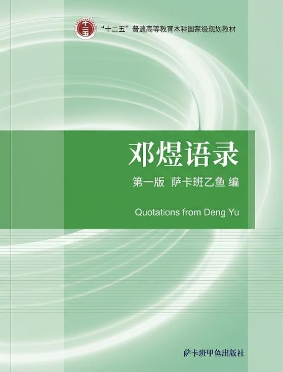
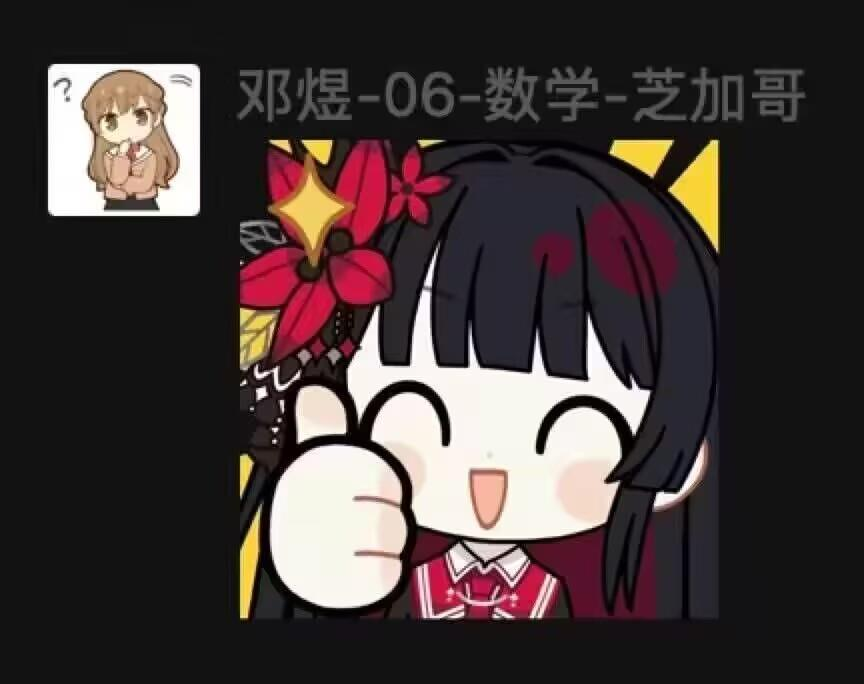
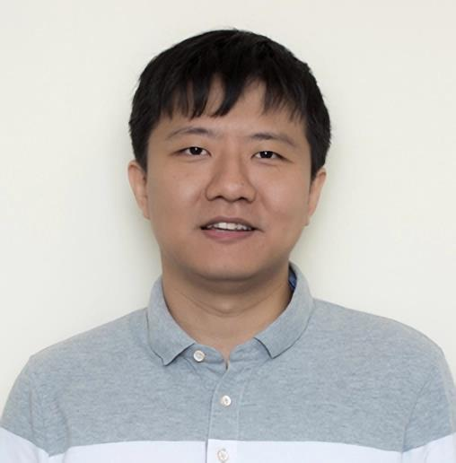

# 邓煜语录

> 愿世界和平, 愿龙怜[^1]结婚.

> “没有什么应用数学, 只有数学的应用.” Arnold[^2] 的很多观点未必靠谱, 但这一条我认为很靠谱.
>
> ——摘自问题《纯数学和应用数学的界线在哪里?》

> 减毒活疫苗. 会被洗脑的一定是本来三观就不正的.
>
> ——摘自问题《如何看待很火的日本页游〈舰队 collection〉中的二战军国主义元素?》

> 男性的人生应该以什么为重? 不过是确定并实现自己的人生价值而已, 与性别何干?
>
> ——摘自问题《女性的人生应该以什么为重?》

> 至于说日常, 大概也就是在家或办公室算题目, 打 paper, 写百合文(划掉), 肝舰 C(划掉), 想见老板去见老板, 或者和合作者讨论, 或者去系里聊天, 听报告顺便吃饭, 这样?
>
> ——摘自问题《在北美名校读数学博士是怎样的体验?》

> 只要你有一颗少女心, 看什么都是少女漫.
>
> ——摘自问题《百合漫属于少女漫吗?》

> 不应该. 因为和生命等值的只能是生命.
>
> ——摘自问题《中国应不应该现在取消死刑?》

> 写同人固然有文学创作的成分, 但所融入的情感更多还是“希望她们能幸福”这样作为旁观者的心态吧(尽管有着“这样的故事别人也许写不出来”的私心), 毕竟这是“她们(人生)的故事”而不仅仅是“我(创作)的故事”呢.
>
> ——摘自问题《最让你体会到创造乐趣的作品是什么?》

> 对早日 tenure[^3]的憧憬咯.
>
> ——摘自问题《是什么支持你念完博士?》

> 反正我的孩子得跟我姓，以后发文章篇篇一作[^4]多方便^=^
>
> ——摘自问题《有多少男士可以接受「男孩跟爸爸姓，女孩跟妈妈姓」? 有多少男女可以接受取消姓氏?》

> 当然没有. 这 tm 不是常识么. 举报里居然没有一个“问题过于愚蠢”的选项我也是醉了.
>
> ——摘自问题《人是否有生孩子的义务?》

> 正梦见作为法官和我第二本命一起审判骚扰她女友的痴汉什么的简直太平常…说个离奇的. 高中时候, 有次在想一个很难的竞赛题, 对当时的我来说难到无从下手那种. 苦思了一个晚上毫无进展. 便睡了. 梦见了什么现在完全记不得了, 反正不是九天玄女吧. 然后醒来那一刻, “ 卧槽这题不 tm 是 trivial 的吗! ” 对了, 题目倒是记得很清楚: 求最小的正整数 n, 使得 1/n 的二进制小数表示中能够读出 1, 2, ⋯, 1990 各数的二进制表示. 留给有兴趣的读者作为练习.
>
> ——摘自问题《你做过最离奇的梦是什么?》

> 不知道呢, 大概因为敢流露出这样想法的男人都被我拉黑了吧…
>
> ——摘自问题《为什么部分男性「看不起」女性?》

> 难道不知道和一个 macbook 党谈论 galgame 很失礼嘛╮(╯▽╰)╭
>
> ——摘自问题《好看的百合动漫有哪些?》

> 不懂得尊重女性角色的, 或者根本不懂得什么叫尊重的.
>
> ——摘自问题《日常中有没有一些动漫死宅朋友的生活交流作风令你觉得相当恶心?》

> 到底友善度的是谁在“一见短袖子, 立刻想到白臂膊, 立刻想到全裸体, 立刻想到生殖器, 立刻想到性交, 立刻想到杂交, 立刻想到私生子”啊?! 对了还有那些还有动不动就“湖南江西”[^5]的, 看见大长腿就“能玩一年”的, 见着稍微漂亮些的女孩子就“援力十足”的, 还把你们猥琐不堪的幻想编成什么“排行榜”的, 还有许许多多我懒得列出来的, 对不起, 无论我针不针对, 你们都是垃圾.
>
> ——摘自文章

> 不想写 paper 啊 QAQ
>
> ——摘自问题《读 PDE[^6]方向的数学博士是种怎样的体验?》

> 跟一个连∀xp(x)和∃xp(x) 的区别[^7]都分不清的人废什么话哪.
>
> ——摘自问题《同性恋会导致人类灭亡吗?》

> 轻松啊. 做数学本身钱就少, 要是工作还不轻松的话我们早上街了好嘛╮(╯▽╰)╭
>
> ——摘自问题《读博士到底是比其他工作困难还是轻松?》

> 签名两句, “或看翡翠兰苕上, 未掣鲸鱼碧海中”[^8]. 以前或许见过没什么印象, 直到前几天在中餐馆吃饭的时候看到墙上挂着的书法就是这首诗, 忍不住反复读了几遍. 突然意识到这两句就是在说我啊，便觉得有些惭愧了.
>
> ——摘自问题《你有哪些被某句唐诗“击中”的瞬间?》

> 曾入南宫朝故主, 又萌西木野真姬.
>
> ——摘自问题《有哪些像「安非他命, 如是我闻」这样的无情对?》

> CP 之于角色正如映射之于集合, 态射之于对象, 类似性之于理论, 所以才会有人说(并没有), 萌角色不如萌角色与角色间的 CP, 萌 CP 又不如萌 CP 与 CP 间的贵乱了……
>
> ——摘自问题《当我们在萌 CP 的时候, 我们在萌什么?》

> 不喝啊. 因为不喜欢味道……总的来说数学系这边喝酒也不算很多吧, 咖啡倒是日常. 然而我也不喝咖啡, 还是因为不喜欢味道……一般去咖啡店就点杯橙汁完事. 按说这种情况在日漫会被吐槽像小孩子? 然而还没有人吐槽过我, 稍微有点不爽呢.
>
> ——摘自问题《科研人员经常喝酒吗?》

> 百合文是不是写手少质量低我没法断言, 但如果真有这种情况那绝对是百合作者的锅, 而不是什么男权社会的. 仅仅因为写的主角是女的就“无法在保证合理不出戏的同时发挥其魅力”了, 这算什么花式甩锅啊? 非不能也, 是不为也!
>
> ——摘自问题《百合文数量少写手少质量普遍低是否和男权社会背景有关?》

## 词一首

> 零落天涯长自伴，奈何别去匆匆。且将醉眼望苍穹。银河明灭处，黑洞有无中。
>
> 迭代时空浑沌后，能期几度相逢？愁心覆叠百千重。相思多少意，趋向正无穷。

## 邓煜为你点赞！

## 邓煜教授像

[^1]: 漫画《天才麻将少女》及其衍生作品中清水谷龙华(Shimizudani Ryūka)和园城寺怜(Onjōji Toki)组成的百合 CP.

[^2]: 指的是弗拉基米尔·阿诺德 (Vladimir Igorevich Arnold, 1937-2010), 俄罗斯数学家, 出生于苏联敖德萨, 曾任莫斯科斯捷克洛夫数学研究所首席科学家和巴黎大学数学教授. 这一论断深刻打破了“纯数学”与“应用数学”的绝对壁垒, 指出所有数学工具本质上都是人类理解和解决自然与社会规律的语言.

[^3]: Tenure 即高校赋予教授的终身教职, 意味着若无重大过错, 可永久任职直至退休. 它意味着从此获得坚实的职业安全与学术自由, 得以从“为发表而发表”的压力中解放, 去探索自己真正认为有价值的研究方向.

[^4]: 数学界的论文对多位作者排序时, 习惯按姓氏首字母排序.

[^5]: 湖南的简称是湘, 江西的简称是赣.

[^6]: PDE (Partial Differential Equation) 即偏微分方程, 主要研究多元函数及其偏导数之间的关系, 用于描述和预测物理, 工程等领域中连续介质的波动, 热传导, 扩散及流体运动等动态演化规律与平衡状态.

[^7]: 前者是“对任意 x, 有性质 p(x) ”即全称命题, 后者是“存在 x, 有性质 p(x) ”即特称命题.

[^8]: 这两句诗出自唐代杜甫的《戏为六绝句》之四. 意思是人人都看得到花枝上的翠鸟, 却少有人敢去碧海中搏击巨鲸. 做学问, 搞创作, 应有后者的大气魄.
